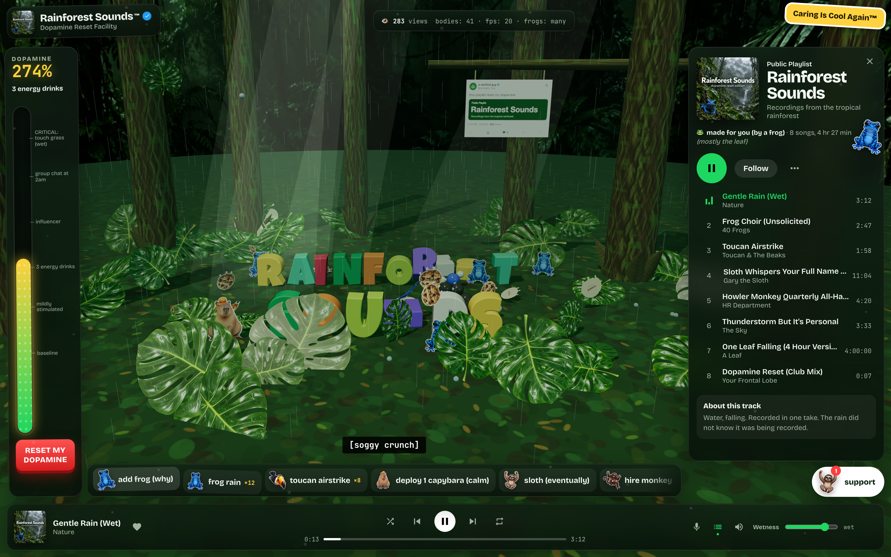
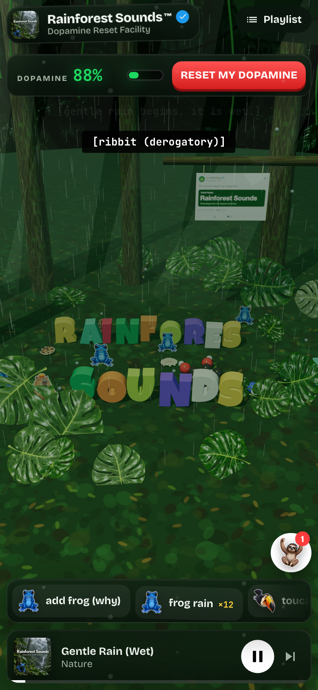

# Rainforest Sounds™

Welcome to the Dopamine Reset Facility. We have frogs, gravity, and a support sloth whose response time is measured in geological eras.

A satirical browser playground disguised as an ambient music app. Pick a rainforest track, adjust the wetness, throw cartoon animals into a 3D physics scene, and ask Gary for help if you have several business years to spare.

## Screenshots

The real WebGL rainforest after entering the app and starting Gentle Rain, captured
locally at 2× resolution. The frogs are browser-rendered; their attitude is built in.





## Run locally

```bash
npm ci
npm run dev
```

Open the local URL Vite prints. To build and inspect the production bundle:

```bash
npm run build
npm run preview
```

## What's in the jungle

- `src/ui/`: player, playlist, chaos controls, popups, and Gary's canned support replies.
- `src/world/`: Three.js scene, Rapier physics, textures, and synthesized Web Audio sounds.
- `src/tracks.ts`: the playlist's suspiciously confident track descriptions.
- `public/assets/`: optimized illustrations used by the website.
- `assets-src/`: original artwork and generation prompts.

Built with TypeScript and Vite. The sounds and support replies run locally in the browser; no API key is needed to run the website. Local job logs, deployment metadata, dependencies, and build output stay out of Git. The frogs demanded a smaller suitcase.
