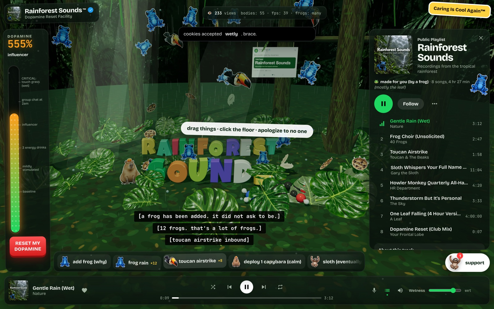
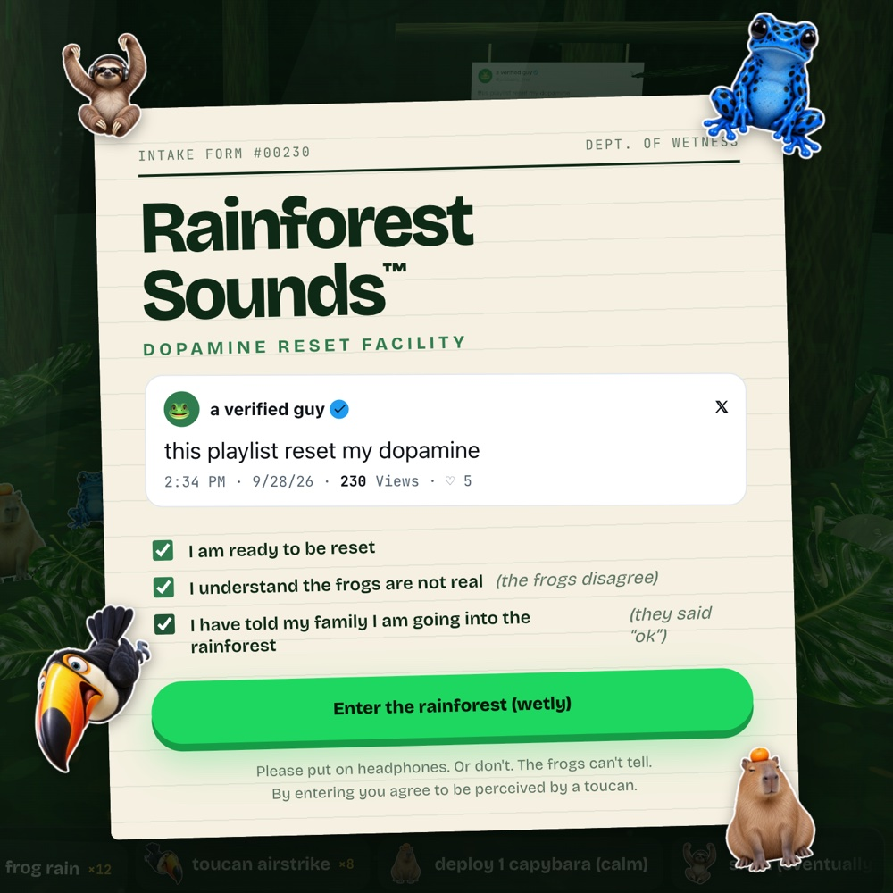
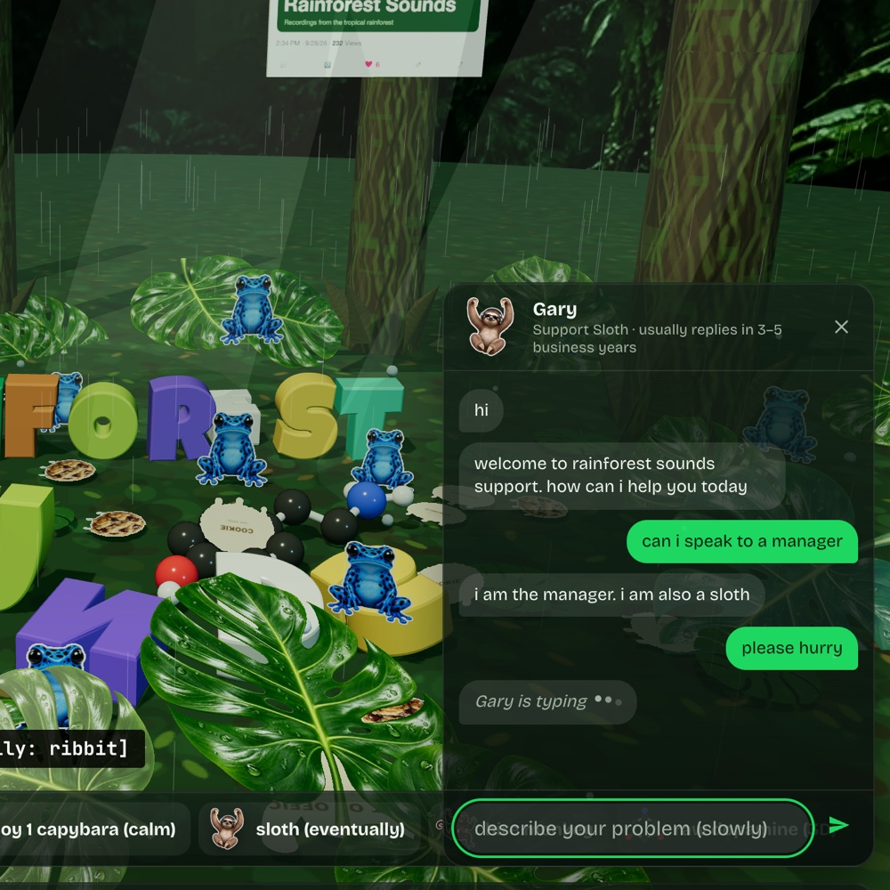
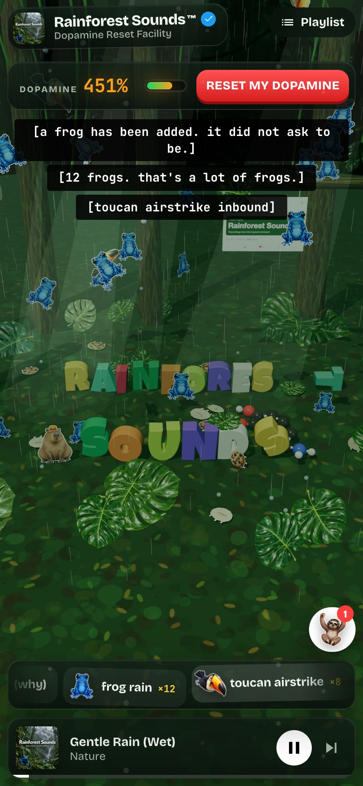

# 🐸 Rainforest Sounds™

> Welcome to the Dopamine Reset Facility. We have frogs, gravity, and a support sloth whose response time is measured in geological eras.

[](https://davidyen1124.github.io/rainforest-sounds/)

**Enter the rainforest (wetly): <https://davidyen1124.github.io/rainforest-sounds/>**

## What is this?

A satirical browser playground disguised as an ambient music app. Pick a rainforest track, adjust the wetness, throw cartoon animals into a 3D physics scene, and ask Gary for help if you have several business years to spare.

It is built around one post: "this playlist reset my dopamine". So there is a playlist, there is a dopamine meter, and there is a big red button that resets it. The post itself hangs from a branch in the scene. Every time something hits it, it gets a like.

The player works. Eight tracks, play, pause, skip, shuffle, repeat. Each track does something different to the rainforest, and closed captions describe what you are hearing, for example `[frog making direct eye contact]`.

Everything on this page is a real screenshot of the site. The frogs are browser-rendered; their attitude is built in.

| Admissions | Customer support |
|---|---|
|  |  |

## How to use

1. Fill in the intake form. Two boxes are ticked for you. The third asks whether you have told your family you are going into the rainforest. Tick it. They said "ok".
2. Press **Enter the rainforest (wetly)**. Gentle Rain starts, and the title falls out of the sky one letter at a time.
3. Add animals from the toolbar: `add frog (why)`, `frog rain ×12`, `toucan airstrike ×8`, `deploy 1 capybara (calm)`, and six more. Or click the jungle floor and something lands exactly there.
4. Drag things. Frogs, bananas, the letter S, the post. Let go fast enough and the captions report the speed in km/h.
5. Choose a gravity: `normal`, `moon`, `sideways (why)`, `upside down`, or `emotional`.
6. Adjust the **Wetness**. This is the volume. It goes from "bone dry" to "SOAKED".
7. When the meter reads `CRITICAL: touch grass (wet)`, press **Reset my dopamine**. Everything is launched into the air, the meter drops to 0%, and a sad trombone plays. Please do not enjoy anything for 6–8 business days.

Keyboard: `Space` plays and pauses, `F` adds a frog, `T` calls the toucans, `C` deploys a capybara, `M` adds a dopamine molecule, `N` toggles nonchalance, and `←` `→` change track.



It works on a phone. The camera pulls back on narrow screens so the frogs remain in frame (legal requirement).

## The playlist

8 songs, 4 hr 27 min. Four hours of that is the leaf.

| Track | Length | About this track | What it does to the rainforest |
|---|---|---|---|
| **Gentle Rain (Wet)** · Nature | 3:12 | Water, falling. Recorded in one take. The rain did not know it was being recorded. | It rains. A leaf comes down every few seconds. This is the calm one. |
| **Frog Choir (Unsolicited)** · 40 Frogs | 2:47 | Nobody asked the frogs. The frogs are aware nobody asked. | The frogs sing a pentatonic melody at 112 bpm, and one of them jumps on every note. Credited to 40 frogs. The caption admits to 16. |
| **Toucan Airstrike** · Toucan & The Beaks | 1:58 | Contains strong beak. Listener discretion advised. | 140 bpm. A toucan dives in every two beats until 28 have arrived. |
| **Sloth Whispers Your Full Name (0.25x)** · Gary the Sloth | 11:04 | Gary has been whispering since 2019. He is on the second syllable. | A very large sloth descends and the physics drops to 0.3× speed. The title says 0.25×. Nobody has told Gary. |
| **Howler Monkey Quarterly All-Hands** · HR Department | 4:20 | This meeting could have been a screech. | Four monkeys hold a meeting. Once a bar, one of them howls and throws two bananas at the camera. Each banana is an action item. |
| **Thunderstorm But It's Personal** · The Sky | 3:33 | The sky read your group chat. | Lightning every few seconds. Each strike briefly changes which way is down. |
| **One Leaf Falling (4 Hour Version)** · A Leaf | 4:00:00 | Critics call it "a leaf" and "still going". | The rain stops. One oversized leaf drifts down while every creature turns to watch. The music is a single note. It really does run for four hours. |
| **Dopamine Reset (Club Mix)** · Your Frontal Lobe | 0:07 | Seven seconds. Life-changing. Legally we cannot say that. | Five seconds of build-up, then the drop. Everything in the scene is thrown into the air and the meter goes to zero. |

## FAQ

**Did it reset my dopamine?**
The meter went to 0%, so technically yes. The meter measures how many objects are in the scene and how fast they are moving. It is not connected to you in any way.

**Are these real rainforest recordings?**
The playlist says "Recordings from the tropical rainforest". There are no audio files in this repo. The rain is filtered noise. A frog is a sawtooth wave at around 100 Hz that goes "rib" and then "bit".

**Is Gary an AI?**
Gary is 13 canned replies and 9 keyword matches. Nothing is sent anywhere. He waits, shows "Gary is typing", and then types about three characters a second. "hi" takes him roughly nine seconds. Ask for a manager and he will usually say "i am the manager. i am also a sloth". Ask about a refund: "refunds are processed in 3–5 business years".

**A frog asked for my location and microphone.**
That prompt is a drawing of a permission prompt. Nothing is requested from your browser. If you block it, 25 frogs are dispatched, and it asks again 45 seconds later.

**What do the cookies do?**
"This rainforest uses cookies. The cookies are wet." Nothing is stored. Accept and three wet cookies are delivered physically. Accept wetly and it is twelve. Reject and you get fifteen frogs instead.

**Why is the capybara so calm?**
It is seven times denser than a frog and bounces less than any other animal. This was the closest the physics engine had to inner peace.

**What does "act nonchalant" do?**
Every creature slowly turns its back on you. The interface goes grey and the labels stop trying: `add frog (why)` becomes `frog i guess`. The **Caring Is Cool Again™** badge undoes it.

**Can I skip to the good part of a track?**
"seeking is not supported in nature. please wait like a tree."

**How many frogs is too many?**
The counter at the top goes `few`, `some`, `many`, `too many`, `please stop`. At about 230 objects the oldest one is quietly recycled.

## What's inside

- **Two halves and a bus.** [`src/ui/`](src/ui) is plain DOM and CSS with no framework. [`src/world/`](src/world) is the 3D scene. Neither imports the other. They talk through a small typed event bus ([`src/bus.ts`](src/bus.ts)). The world is loaded lazily, which is why the button on the intake form says "loading frogs…" for a moment.
- **Rendering:** [three.js](https://threejs.org). The animals are flat die-cut stickers with the art on the front and cardboard on the back. Every animal's back has a label. The frog's says "BACK OF FROG, not currently accepting feedback". The title is extruded 3D text set in Luckiest Guy (Astigmatic, Apache 2.0). The ground and the bark are painted onto a canvas at load time.
- **Physics:** [Rapier](https://rapier.rs) (WASM) at 60 Hz. Stickers and letters are boxes. The dopamine molecule is a ball-and-stick C8H11NO2 with a collider on every atom, hydrogens mostly omitted for your comfort. The post hangs from its branch on two joints. Some of the raindrops are real bodies, so they land on things and go plink.
- **The dopamine meter:** a comment in the source describes it as "just kinetic energy with a marketing budget". That is the whole design. After a reset it is held at zero for two and a half seconds and then allowed to creep back.
- **Sound:** [`src/world/audio.ts`](src/world/audio.ts) synthesizes everything with Web Audio: a noise bed for the rain, a pad, and 21 small voices from `croak` to `sadTrombone`. Three of the tracks run on a 16th-note step sequencer, and the visuals are scheduled against the audio clock, so a frog jumps on the note and not near it. A compressor on the master keeps 40 simultaneous frogs from clipping.
- **Art:** the stickers, cover, backdrop and social card were generated with an image model. The final prompts are in [`assets-src/generation-prompts.txt`](assets-src/generation-prompts.txt). They specify, among other things, that the capybara has "a single small mandarin orange balanced on its head".
- **No backend.** No API key, no analytics, nothing stored. The view counter starts at 230 and goes up on a timer. The only requests that leave the site are for two Google Fonts, Bricolage Grotesque and JetBrains Mono.
- **Size:** about 5 MB of JavaScript (1.8 MB gzipped). 4.1 MB of that is the physics engine. The frogs are heavier than they look.

## Run it locally

```bash
npm ci
npm run dev        # http://localhost:5173
npm run build      # type-checks, then writes the static site to dist/
npm run preview    # serves dist/
```

Built with TypeScript and Vite. In the browser console, `rainforest` exposes the world, the director and the bus, which is handy for poking frogs:

```js
rainforest.bus.emit('spawn', { kind: 'capybara', count: 40 })
```

## What's in the jungle

- [`src/ui/`](src/ui): player, playlist, chaos controls, popups, and Gary's canned support replies.
- [`src/world/`](src/world): three.js scene, Rapier physics, textures, synthesized Web Audio sounds, and the director that decides what each track does.
- [`src/tracks.ts`](src/tracks.ts): the playlist's suspiciously confident track descriptions.
- [`src/bus.ts`](src/bus.ts), [`src/asset.ts`](src/asset.ts), [`src/main.ts`](src/main.ts): the event bus, the helper that builds asset URLs, and the entry point.
- [`public/`](public): files served as they are. `public/assets/` holds the optimized illustrations and the social card.
- [`assets-src/`](assets-src): original artwork and generation prompts. The site does not ship these.
- [`docs/screenshots/`](docs/screenshots): the screenshots in this README.
- [`.github/workflows/pages.yml`](.github/workflows/pages.yml): the deploy.
- `index.html`, `vite.config.ts`, `tsconfig.json`, `package.json`: the usual.

Dependencies, build output and local job logs stay out of Git. The frogs demanded a smaller suitcase.

## Deploying

Pushing to `main` runs [a GitHub Actions workflow](.github/workflows/pages.yml) that builds with Vite and publishes `dist/` to GitHub Pages. The build uses relative paths (`base: './'`), so it works under `/rainforest-sounds/` or anywhere else.

## Disclaimer

This is satire. It is not a wellness product, a medical device or a streaming service, and it is not affiliated with one. Seven seconds. Life-changing. Legally we cannot say that.
